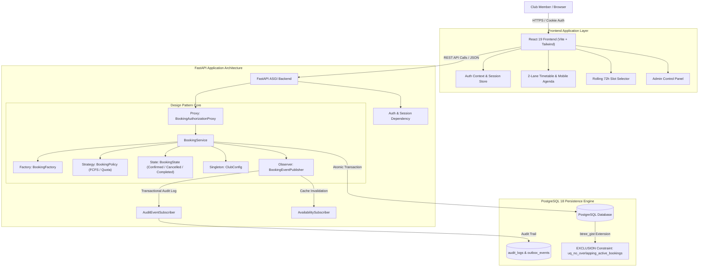
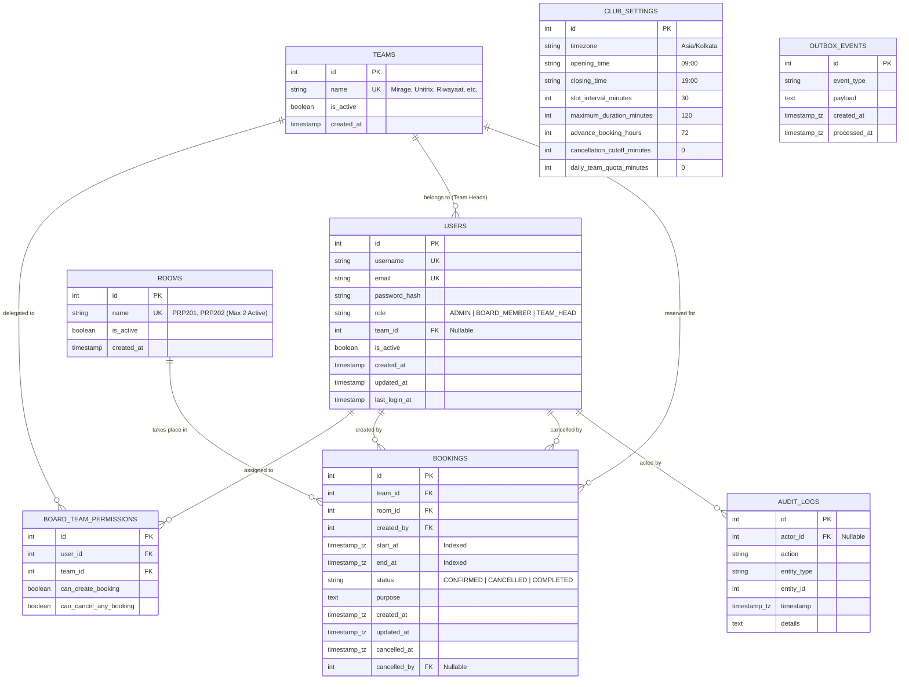
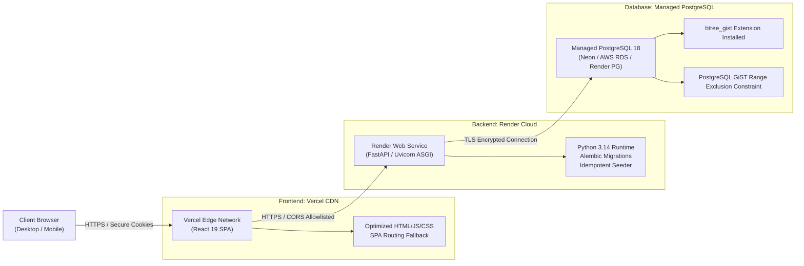

# VIT Dance Club — System Architecture Specification

## 1. System Overview & Architecture Diagram

The **VIT Dance Club Studio Booking System** is an enterprise-grade studio reservation portal engineered for high-concurrency scheduling across 9 dance teams for 2 dedicated campus studios (**PRP201** and **PRP202**).

The architecture cleanly decouples the React TypeScript frontend from the FastAPI Python backend and PostgreSQL persistence engine. Every booking request flows through an authoritative authorization proxy, domain factory, strategy policy, and transactional state engine, enforced at the database level by PostgreSQL GiST range exclusion constraints.



---

## 2. Booking Flow Sequence Diagram

This sequence diagram illustrates the lifecycle of a booking request, demonstrating how authoritative server time, rolling 72-hour windowing, proxy authorization, and atomic PostgreSQL conflict prevention interact.

```mermaid
sequenceDiagram
    autonumber
    actor Member as Board Member / Admin
    participant UI as React UI (Client)
    participant API as FastAPI Router (/api/bookings)
    participant Proxy as BookingAuthorizationProxy
    participant Svc as BookingService
    participant Factory as BookingFactory
    participant Policy as BookingPolicy (Strategy)
    participant PG as PostgreSQL (GiST Range Constraint)
    participant Pub as BookingEventPublisher (Observer)

    Member->>UI: Select Room, Date, 30m Slot, Team
    UI->>API: POST /api/bookings (team_id, room_id, start_at, end_at)
    API->>Proxy: create_booking(actor, team_id, room_id, start_at, end_at)
    
    Note over Proxy: Check actor active status & role permissions
    Proxy->>Proxy: Verify Board Member team delegation in DB
    
    Proxy->>Svc: Forward authorized request
    Svc->>Svc: Capture Authoritative Server Timestamp (Asia/Kolkata)
    
    Svc->>Factory: Validate domain invariants & create Booking
    Note over Factory: Check [server_now <= start < server_now + 72h)<br/>Check 09:00-19:00 IST<br/>Check 30m interval & max 120m duration
    
    alt Slot Outside 72h or Invalid Operating Hours
        Factory-->>Svc: Raise WindowViolation / OperatingHoursException
        Svc-->>API: HTTP 422 Unprocessable Content
        API-->>UI: Display clear window boundary / hours error
    else Slot Valid
        Factory-->>Svc: Valid Booking Domain Instance (CONFIRMED)
        Svc->>Policy: validate_booking_eligibility(team_id, date)
        Policy-->>Svc: Eligible (FCFS / Daily Quota Check)
        
        Svc->>PG: BEGIN TRANSACTION; INSERT INTO bookings ...
        Note over PG: Evaluate GiST Range EXCLUSION Constraint:<br/>room_id WITH = AND tstzrange(start, end, '[)') WITH &&<br/>WHERE status = 'CONFIRMED'
        
        alt Another Transaction Committed First (Collision)
            PG-->>Svc: IntegrityError: ExclusionViolation
            Svc->>PG: ROLLBACK;
            Svc-->>API: HTTP 409 Conflict
            API-->>UI: Display "Slot no longer available" & trigger availability refresh
        else Slot Free (Wins Lock)
            PG-->>Svc: Insert Succeeded
            Svc->>Pub: notify(BOOKING_CREATED, event)
            Pub->>PG: INSERT INTO audit_logs & outbox_events
            Svc->>PG: COMMIT TRANSACTION;
            Svc-->>API: Confirmed Booking Details
            API-->>UI: HTTP 201 Created & Render Reservation Pass
        end
    end
```

---

## 3. Database Entity-Relationship (ER) Diagram



---

## 4. Role-Permission Matrix

| Operation | Club Administrator | Board Member | Team Head |
| :--- | :---: | :---: | :---: |
| **Log in with Credentials** | ✅ | ✅ | ✅ |
| **View Master Timetable / Both Studios** | ✅ | ✅ | ✅ |
| **Filter by Date, Studio, Team, Status** | ✅ | ✅ | ✅ |
| **View Booking Reservation Pass** | ✅ | ✅ | ✅ |
| **Create Studio Booking** | ✅ | ✅ *(Only for delegated teams)* | ❌ *(HTTP 403 Forbidden)* |
| **Cancel Own Team Booking** | ✅ | ✅ *(If creator or delegated)* | ✅ *(Only for own team)* |
| **Cancel Other Team Booking** | ✅ | ❌ *(HTTP 403 Forbidden)* | ❌ *(HTTP 403 Forbidden)* |
| **Bypass 72-Hour Window** | ❌ *(Backend-blocked)* | ❌ *(Backend-blocked)* | ❌ *(Backend-blocked)* |
| **Bypass Room Conflict Protection** | ❌ *(DB-blocked)* | ❌ *(DB-blocked)* | ❌ *(DB-blocked)* |
| **Manage Member Accounts & Roles** | ✅ | ❌ *(HTTP 403 Forbidden)* | ❌ *(HTTP 403 Forbidden)* |
| **Configure Board Team Delegations** | ✅ | ❌ *(HTTP 403 Forbidden)* | ❌ *(HTTP 403 Forbidden)* |
| **Configure Operating Hours & Limits** | ✅ | ❌ *(HTTP 403 Forbidden)* | ❌ *(HTTP 403 Forbidden)* |
| **Activate > 2 Dance Studios** | ❌ *(Enforced limit)* | ❌ *(N/A)* | ❌ *(N/A)* |
| **Inspect Immutable Audit Trail** | ✅ | ❌ *(HTTP 403 Forbidden)* | ❌ *(HTTP 403 Forbidden)* |

---

## 5. Design Pattern Architecture Mapping

| Pattern | Concrete Class / Module | Architectural Responsibility | Automated Test File |
| :--- | :--- | :--- | :--- |
| **Proxy Pattern** | `BookingAuthorizationProxy`<br/>([authorization_proxy.py](file:///C:/Users/srira/.gemini/antigravity/scratch/vit-dance-studio-booking/backend/app/patterns/authorization_proxy.py)) | Intercepts all booking requests, verifies user active status, checks roles and team delegation, enforces cancellation ownership before dispatching to the core service. | [test_design_patterns.py](file:///C:/Users/srira/.gemini/antigravity/scratch/vit-dance-studio-booking/backend/tests/test_design_patterns.py)<br/>[test_permissions.py](file:///C:/Users/srira/.gemini/antigravity/scratch/vit-dance-studio-booking/backend/tests/test_permissions.py) |
| **Strategy Pattern** | `BookingPolicy`<br/>`FirstComeFirstServedPolicy`<br/>`TeamQuotaPolicy`<br/>([booking_policy.py](file:///C:/Users/srira/.gemini/antigravity/scratch/vit-dance-studio-booking/backend/app/patterns/booking_policy.py)) | Defines interchangeable booking validation algorithms. FCFS allows immediate database competition; TeamQuota enforces daily duration limits per team. Injected into `BookingService`. | [test_design_patterns.py](file:///C:/Users/srira/.gemini/antigravity/scratch/vit-dance-studio-booking/backend/tests/test_design_patterns.py) |
| **Factory Method Pattern** | `BookingFactory`<br/>([booking_factory.py](file:///C:/Users/srira/.gemini/antigravity/scratch/vit-dance-studio-booking/backend/app/patterns/booking_factory.py)) | Produces valid Booking domain models, enforcing required fields, rolling 72-hour limits, operating hours (09:00-19:00), 30m intervals, max 120m duration, and initial CONFIRMED state. | [test_design_patterns.py](file:///C:/Users/srira/.gemini/antigravity/scratch/vit-dance-studio-booking/backend/tests/test_design_patterns.py)<br/>[test_rolling_72hr.py](file:///C:/Users/srira/.gemini/antigravity/scratch/vit-dance-studio-booking/backend/tests/test_rolling_72hr.py) |
| **State Pattern** | `BookingState`<br/>`ConfirmedState`<br/>`CancelledState`<br/>`CompletedState`<br/>([booking_state.py](file:///C:/Users/srira/.gemini/antigravity/scratch/vit-dance-studio-booking/backend/app/patterns/booking_state.py)) | Controls permissible lifecycle transitions (CONFIRMED -> CANCELLED, CONFIRMED -> COMPLETED). Disallows invalid operations (e.g. CANCELLED -> CANCELLED, COMPLETED -> CANCELLED). | [test_design_patterns.py](file:///C:/Users/srira/.gemini/antigravity/scratch/vit-dance-studio-booking/backend/tests/test_design_patterns.py)<br/>[test_booking_rules.py](file:///C:/Users/srira/.gemini/antigravity/scratch/vit-dance-studio-booking/backend/tests/test_booking_rules.py) |
| **Observer Pattern** | `BookingEventPublisher`<br/>`AuditEventSubscriber`<br/>`AvailabilitySubscriber`<br/>([booking_observer.py](file:///C:/Users/srira/.gemini/antigravity/scratch/vit-dance-studio-booking/backend/app/patterns/booking_observer.py)) | Dispatches booking lifecycle events (CREATED, CANCELLED). Subscribers persist audit trail records and transactional outbox entries within the same database transaction. | [test_design_patterns.py](file:///C:/Users/srira/.gemini/antigravity/scratch/vit-dance-studio-booking/backend/tests/test_design_patterns.py) |
| **Singleton Pattern** | `ClubConfig`<br/>([club_config_singleton.py](file:///C:/Users/srira/.gemini/antigravity/scratch/vit-dance-studio-booking/backend/app/patterns/club_config_singleton.py)) | Process-level thread-safe Singleton caching default non-secret operational parameters (timezone, opening/closing hours, slot intervals, max duration) with database synchronization and cache reload. | [test_design_patterns.py](file:///C:/Users/srira/.gemini/antigravity/scratch/vit-dance-studio-booking/backend/tests/test_design_patterns.py) |

---

## 6. Production Deployment Architecture Diagram


